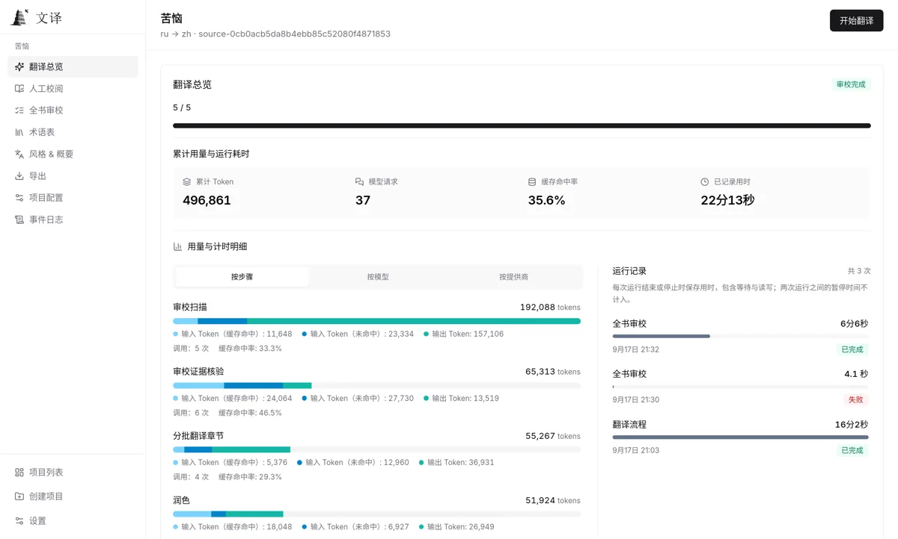

<div align="center">

<h1>
  
  <br>
  
</h1>

**Whole-book understanding · Consistent terminology · Evidence-based review**


[](https://github.com/Malte-Dzierzon/wenyi/actions/workflows/tests.yml)
[](LICENSE)

<a href="docs/images/web-translation-overview.png"></a>

</div>

---

## Wenyi stack

| Layer | Software |
|---|---|
| Engine | Python `wenyi-core` — pipeline, glossary, review, ingest/assemble |
| CLI | `wenyi translate` via [uv](https://docs.astral.sh/uv/) (Python 3.10+) |
| Desktop | Rust `wenyi-native` UI + [Tauri 2](https://tauri.app) shell, private Python sidecar |
| Web / API | [React 19](https://react.dev) + [Vite 6](https://vite.dev) frontend, Python API + [Arq](https://github.com/python-arq/arq) workers (PostgreSQL/Redis) |
| Models | 10 provider kinds — DeepSeek, OpenAI, OpenRouter, Gemini, Ollama, vLLM, llama.cpp, OrcaRouter, opencode-go, OpenAI-compatible |
| Storage | File (CLI) · SQLite (Desktop) · PostgreSQL (Web) |
| Formats | EPUB/FB2/TXT/Markdown/HTML/PDF/DOCX/SRT in · EPUB/TXT/HTML/Markdown/PDF/DOCX + SRT out |

---

## Quick start

The CLI runs the full pipeline locally; `uv` installs the workspace, one env var connects a model.

```bash
uv sync --locked
export DEEPSEEK_API_KEY="YOUR_DEEPSEEK_API_KEY"
uv run wenyi translate book.epub
```

Special cases:

- Desktop app: [releases + run from source](docs/desktop.md#quick-start) (packaged builds need no Python).
- Native Rust UI preview: [`apps/desktop/native/`](apps/desktop/native/) talks to the same sidecar contract ([parity plan](docs-next/18-desktop-parity.md)).
- Self-hosted web workspace (PostgreSQL/Redis/Docker): [Web deployment](docs/web.md).

---

## Features

- **Whole-book understanding** — prescans the source before translation, building per-chapter digests and a book-level synopsis injected into every batch.
- **Real-time glossary** — extracts terms as translation progresses, with conflict detection.
- **Multi-stage quality** — batch translation, optional polishing, and evidence-driven whole-book review.
- **Resumability** — batch checkpoints and chapter status tracking; reopen a project and continue.
- **Multiple LLM providers** — 10 routed kinds with per-operation tiers, retries, and usage accounting.
- **Formats** — EPUB, FB2, TXT, Markdown, HTML, PDF, DOCX, and SRT subtitle input; EPUB/TXT/HTML/Markdown/PDF/DOCX book output plus SRT subtitles.

<details>
<summary><b>Limitations</b></summary>

- Multilingual translation is experimental; real-model long-form quality needs further evaluation.
- Polishing and final review are the most expensive stages.
- PDF input defaults to MinerU and requires an API key for the initial conversion.
- SRT translation does not include a glossary, polishing, or whole-book review.
- Translation quality is bounded by the capabilities of the chosen LLM model.

</details>

---

## Repository

<details>
<summary><b>Apps</b></summary>

- `apps/desktop/` — Tauri shell + React frontend + `wenyi_desktop` sidecar + `native/` Rust UI
- `apps/web/` — React browser workspace
- `apps/api/` — Python API + Arq workers

</details>

<details>
<summary><b>Packages</b></summary>

- `packages/core/` — `wenyi-core` engine: pipeline, glossary, LLM routing, ingest/assemble
- `packages/cli/` — `wenyi` command
- `packages/backend/` — shared HTTP routes and app services
- `packages/ui/` — shared React pages and components
- `packages/shared-schema/` — generated API types

</details>

<details>
<summary><b>Docs</b></summary>

- [Desktop](docs/desktop.md) · [CLI](docs/cli.md) · [Configuration](docs/configuration.md) · [Pipeline](docs/pipeline.md) · [Architecture](docs/architecture.md) · [Web](docs/web.md)
- [`docs-next/`](docs-next/) — Rust rewrite plan (vision → migration roadmap)
- [`docs/roadmap-custom.md`](docs/roadmap-custom.md) — this fork's change log
- [`CONTRIBUTING.md`](CONTRIBUTING.md) — upstream development guidelines

</details>

---

## About this fork

Fork of [BigDawnGhost/wenyi](https://github.com/BigDawnGhost/wenyi) with full history; upstream stays the reference for the shipped codebase.

Direction: single native Rust desktop app, no web product ([vision](docs-next/01-project-vision.md)). Current state: the Rust UI runs beside Tauri on the same sidecar contract while the backend stays Python with targeted extensions — parallel chapter workers, glossary curator, llama.cpp provider. Tracked in [`docs/roadmap-custom.md`](docs/roadmap-custom.md).

---

## License

[MIT](LICENSE) — Copyright (c) 2026 BigDawnGhost.
