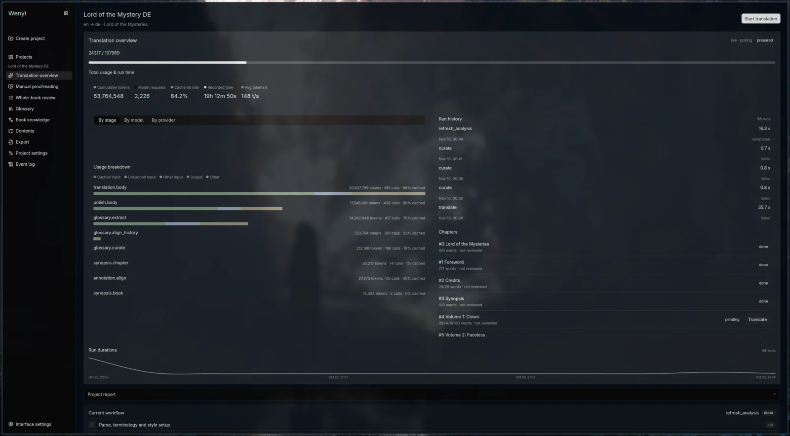
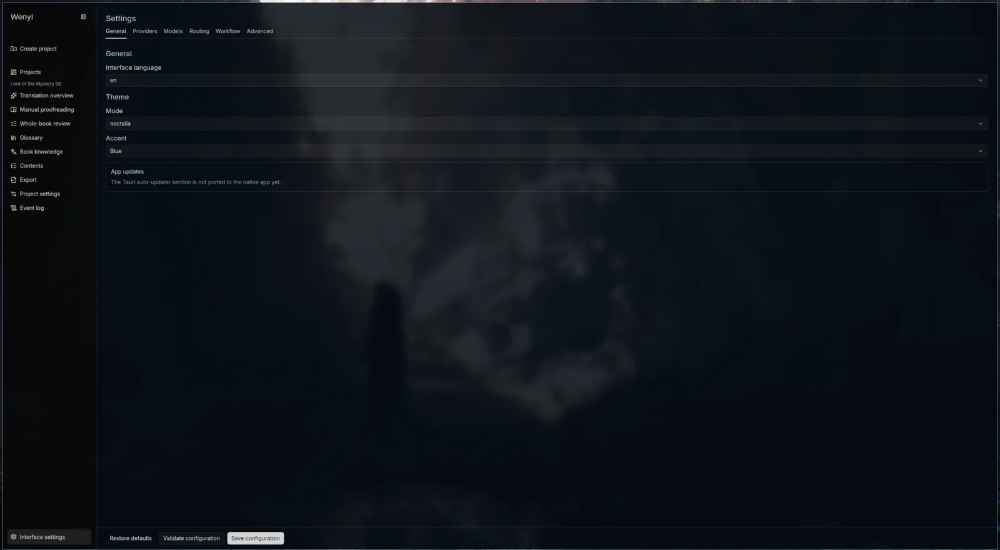

<div align="center">

# Wenyi

**Whole-book understanding · Consistent terminology · Evidence-based review**


[](https://github.com/Malte-Dzierzon/wenyi/actions/workflows/tests.yml)
[](LICENSE)





</div>

---

## Wenyi stack

| Layer | Software |
|---|---|
| Desktop UI | Rust `wenyi-native` ([gpui-kit 0.8](https://crates.io/crates/gpui-kit)), private Python sidecar over loopback REST (until the Rust engine lands) |
| Engine reference | Python `wenyi-core` — pipeline, parallel chapter workers, glossary curator, review, ingest/assemble (read-only oracle for the rewrite) |
| Models | 10 routed provider kinds — DeepSeek, OpenAI, OpenRouter, opencode-go, OrcaRouter, Ollama, vLLM, llama.cpp, Gemini, OpenAI-compatible |
| Storage | SQLite workspace (`local.sqlite3` + per-project `state.sqlite3`) |
| Formats | EPUB/TXT/Markdown/FB2/HTML/PDF/DOCX/SRT in · EPUB/TXT/HTML/Markdown/PDF/DOCX + SRT out |

Target: one native Rust app end to end — see [Rust rewrite plan](docs/RUST-REWRITE.md).

---

## Quick start

```bash
uv sync --locked
export DEEPSEEK_API_KEY="YOUR_DEEPSEEK_API_KEY"
cargo run --manifest-path apps/desktop/native/Cargo.toml
```

The native UI spawns the Python sidecar automatically in dev (`WENYI_DESKTOP_PYTHON`
selects the interpreter). Packaged builds need no Python once the Rust engine lands.

Special cases:

- Desktop behavior, settings, workspace layout: [Desktop](docs/desktop.md).
- Engine behavior reference: [Pipeline](docs/pipeline.md) · [Configuration](docs/configuration.md) · [Architecture](docs/architecture.md).
- Fork change log: [`docs/roadmap-custom.md`](docs/roadmap-custom.md).

---

## Features

- **Whole-book understanding** — prescans the source before translation, building per-chapter digests and a book-level synopsis injected into every batch.
- **Real-time glossary** — extracts terms as translation progresses, with conflict detection.
- **Multi-stage quality** — batch translation, optional polishing, and evidence-driven whole-book review.
- **Resumability** — batch checkpoints and chapter status tracking; reopen a project and continue.
- **Multiple LLM providers** — 10 routed kinds with per-operation tiers, retries, and usage accounting.
- **Formats** — EPUB, FB2, TXT, Markdown, HTML, PDF, DOCX, and SRT subtitle input; EPUB/TXT/HTML/Markdown/PDF/DOCX book output plus SRT subtitles.

<details>
<summary><b>Limitations</b></summary>

- Multilingual translation is experimental; real-model long-form quality needs further evaluation.
- Polishing and final review are the most expensive stages.
- PDF input defaults to MinerU and requires an API key for the initial conversion.
- SRT translation does not include a glossary, polishing, or whole-book review.
- Translation quality is bounded by the capabilities of the chosen LLM model.

</details>

---

## Repository

<details>
<summary><b>Apps</b></summary>

- `apps/desktop/native/` — Rust GPUI desktop UI (`wenyi-native`)
- `apps/desktop/backend/` — `wenyi_desktop` Python sidecar (temporary reference)

</details>

<details>
<summary><b>Packages</b></summary>

- `packages/core/` — `wenyi-core` engine reference: pipeline, glossary, LLM routing, ingest/assemble
- `packages/backend/` — HTTP routes and app services used by the sidecar

</details>

<details>
<summary><b>Docs</b></summary>

- [Rust rewrite plan](docs/RUST-REWRITE.md) · [Desktop](docs/desktop.md) · [Configuration](docs/configuration.md) · [Pipeline](docs/pipeline.md) · [Architecture](docs/architecture.md)
- [`docs/roadmap-custom.md`](docs/roadmap-custom.md) — this fork's change log
- [`CONTRIBUTING.md`](CONTRIBUTING.md) — development guidelines

</details>

---

## About this fork

Fork of [BigDawnGhost/wenyi](https://github.com/BigDawnGhost/wenyi) with full history; upstream stays the reference for the shipped codebase.

Direction: single native Rust desktop app, no web product ([rewrite plan](docs/RUST-REWRITE.md)). Current state: the Rust UI runs on a Python sidecar while the Rust engine is built — parallel chapter workers, glossary curator, llama.cpp provider. Tracked in [`docs/roadmap-custom.md`](docs/roadmap-custom.md).

---

## License

[MIT](LICENSE) — Copyright (c) 2026 BigDawnGhost.
