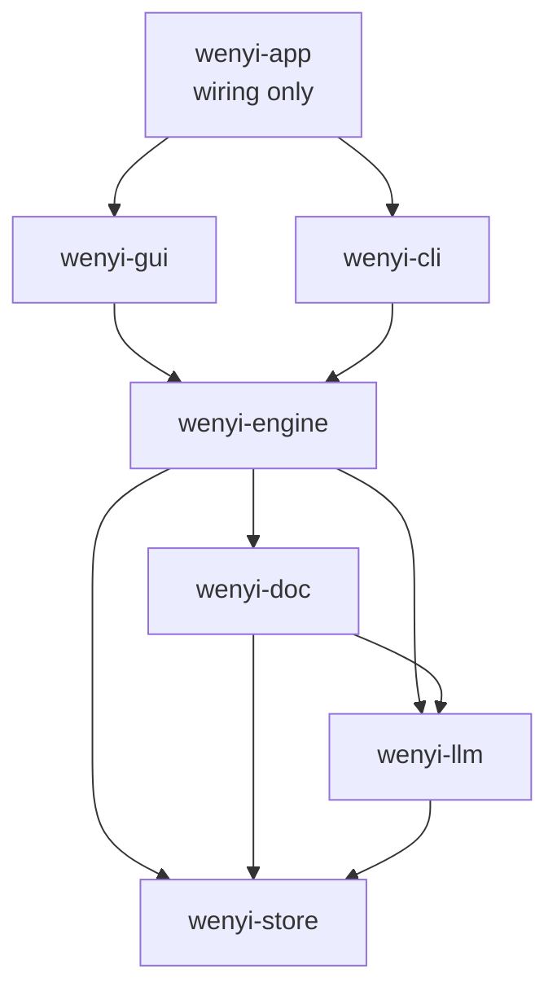

# Target architecture — Rust modular monolith

Single binary, SQLite only, no network product surface. Cargo workspace, crate
responsibilities, and dependency rules carrying today's Python boundaries
(`AGENTS.md`) into Rust. Detail docs: engine 07, providers 08, formats 09,
GUI 10, config 11, storage 12, reliability 13, testing 14.

## 1. Workspace layout

```text
wenyi/                       # new Rust repo (or ~/projects/wenyi/rust/)
  Cargo.toml                 # workspace + shared lints
  crates/
    wenyi-store/             # Storage traits + SQLite implementation
    wenyi-llm/               # provider clients, routing, retry, usage ledger
    wenyi-doc/               # ingest readers, assemble writers, markup, glossary,
                             # review-evidence, i18n data, prompts (pure + I/O libs)
    wenyi-engine/            # pipeline services + Orchestrator facade
    wenyi-gui/               # desktop GUI (GPUI-Kit 0.8, doc 10), screens, event bus view
    wenyi-cli/               # CLI binary commands (clap)
    wenyi-app/               # production binary: wires engine+gui/cli, tray,
                             # single-instance, updater, keyring, file dialogs
```

## 2. Crate diagram



Dependency direction is strictly downward. `wenyi-app` contains `main.rs`,
platform glue, and nothing else with business logic.

## 3. Crate responsibilities and rules

| Crate | Owns (ported from) | MUST NOT depend on |
|---|---|---|
| `wenyi-store` | `Storage`/`ArtifactStorage` traits (`storage/protocol.py:20,30`); `SqliteStorage` (`storage/sqlite.py:34`); `RunStore` paths/locks (`pipeline/runstore.py:48`); usage/event append-once ledger (`llm/usage.py`, `pipeline/runstore.py:104`) | engine, llm, doc, gui, cli, app |
| `wenyi-llm` | 10 provider clients (`llm/providers/`, `llm/registry.py:113-139`); tiers + operations (`llm/operations.py:14`); routing (`llm/routing.py:112`); unified retry (`llm/retrying.py:359`); credentials hygiene (`llm/credentials.py:7`); transports for MinerU/BabelDOC HTTP | engine, doc, gui, cli, app |
| `wenyi-doc` | all readers (`ingest/`), all writers (`assemble/`), `markup/`, `document_styles/`, `glossary/`, `review/` (models/contracts/evidence/session), `postprocess/`, `srt/`, `i18n/data` + `agents/prompts.py` as embedded resources | engine, gui, cli, app |
| `wenyi-engine` | `Orchestrator` facade (`pipeline/orchestrator.py:30`); `PreparationService`, `TranslationService`, `ReviewService`, `ReviewAutofixService`, `ReportService`, `AssemblyService`; agents (`agents/`); SRT flow (`srt/translate.py:180`) | gui, cli, app; never touches SQLite/files except through `wenyi-store` traits |
| `wenyi-gui` | 13-screen UX spec (04 §1); event-kind taxonomy from `ws.ts:7,111`; operation catalog from `lib/api.ts:52-281`; `PlatformServices` seam concept (`platform.ts:34`) | cli; calls engine in-process (no HTTP) |
| `wenyi-cli` | command surface spec (04 §2: parse/translate/prepare/review/status/assemble/report/language-policy/languages/glossary/models) | gui, app |
| `wenyi-app` | single-instance + tray + updater + dialogs + keyring wiring (behavior spec: `apps/desktop/src/*.rs`, `wenyi_desktop/local_credentials.py:70`, `updates.py:16`, `desktop.py:61`) | nothing may import app |

Rules (ported from `AGENTS.md` architecture boundaries):

1. `wenyi-engine` is a thin facade: step routing + lock scopes only, mirroring
   `orchestrator.py:30-56`. Never imports provider SDKs, format parsers, or
   GUI/CLI types.
2. All state goes through `wenyi-store` traits. No `std::fs` run-state writes
   and no `rusqlite` use outside `wenyi-store`.
3. `wenyi-doc` is side-effect-free except explicit read/write functions taking
   paths; it never sees run state.
4. Shadow-only review is a type rule: review functions return provisional
   patches; only autofix, holding an explicit publish capability, may write
   formal chapters — after writing the recoverable index (doc 07 §5).
5. Concurrency lives in domain services; results merge in stable original
   order. SRT stays independent of the book orchestrator.

## 4. State design (SQLite)

One SQLite file per project plus a `catalog.sqlite` for project/job listings
(full schema: doc 12). Key mappings: `target NULL` = pending (`""` valid, never
truth-tested); manifest row committed last; usage/events append-only; review
runs + recoverable autofix index in tables. Lock scopes from
`runstore.py:71-99` become `try_lock` + rusqlite transactions; export
snapshots read from one committed transaction.
## 5. Event and progress design

`LocalRuntime` + `ProgressHub` become tokio tasks + a broadcast bus. The WS
kind taxonomy (`snapshot|stats|state|progress|batch|chapter|term|pipeline|log|final`)
becomes the Rust event enum — same names, in-process delivery, coalescing kept
(doc 13 §5). GUI subscribes; CLI prints.

## 6. Crate shortlist (versions verified 2026-10-25 via docs.rs)

| Crate | Version | One-line justification |
|---|---|---|
| tokio | 1.54.1 | Async runtime for LLM fan-out, progress bus, and single-binary task wiring. |
| reqwest | 0.13.5 | Only HTTP client needed: 10 OpenAI-compatible provider APIs + MinerU/BabelDOC bridges (rustls-tls, matches `apps/desktop/Cargo.toml:20`). |
| serde / serde_json | 1.0.229 / 1.0.154 | Manifest/chapter JSON state + provider wire format; pickup for pydantic models. |
| rusqlite (bundled) | 0.40.2 | Single embedded project DB with `bundled` SQLite — no system-lib dependency on openSUSE; sync access behind the store's lock module fits the lock-scope design, so sqlx 0.9.0 is rejected (async + migrations + compile cost buy nothing without PG). |
| zip | 9.0.5 | EPUB/DOCX are ZIPs; direct control of entries preserves round-trip fidelity (TOC, anchors, styles). |
| quick-xml | 0.42.0 | OPF/NCX/NAV + DOCX `document.xml` read/write with streaming performance. |
| scraper (html5ever 0.40.1) | 0.29.0 | HTML ingest/repair with browser-grade parsing; CSS selectors for chapter splitting. |
| tracing (+ tracing-subscriber) | 0.1 | Structured spans/events replacing the Python event log + timing (`timing.py`) for pipeline observability. |
| clap (derive) | 4.5.x | CLI spec (04 §2) needs subcommands, help panels, and `--translation-mode` enums. |
| keyring | 3.0.5 | System-keyring-first credentials with memory-only fallback, porting `CredentialStore` (`local_credentials.py:70`); must enable explicit platform features (v3 has no default features). |
| tiktoken-rs | 0.12.1 | Token budgets and batch sizing must match today's tiktoken counts (`ingest/tokens.py`). |
| serde_yaml | 0.9.x | Config file format: same YAML schema as `config.yaml`, defaults render byte-identical (D4 in doc 16). |
| gpui-kit | 0.8.0 (`gpui-pre =0.3.9`) | GUI framework (DECIDED, U0 passed): 75+ components, AccessKit, headless tests; loopback binding first, in-process later (doc 10). |
| thiserror | 2.0.2 | Typed errors replacing `IngestError`/provider-failure normalization with expected-input vs external-service distinction. |
| rfd | (re-verify at build) | Native file dialogs; listed for intent — version not re-verified today, confirm before pinning. |

Hand-rolled EPUB/DOCX over `epub` 2.1.5 / `docx-rs` 0.4.22: `epub` is
read-only, and neither preserves run-level styles, TOC bindings, anchor links,
or bilingual styling (doc 09). Rejected: web frameworks, PG/Redis clients,
Tauri, OpenAI SDK crates (plain `reqwest` keeps provider fields co-located),
PDF-generation equivalents (deferred — doc 16 Q3).

## Sources

- `packages/core/wenyi_core/pipeline/orchestrator.py:30-56`, `runstore.py:48-99`, `finalization.py:65-173`
- `packages/core/wenyi_core/storage/protocol.py:20-63`, `storage/sqlite.py:34`
- `packages/core/wenyi_core/llm/registry.py:113-139`, `operations.py:14`, `routing.py:112`, `retrying.py:359`
- `packages/ui/src/lib/api.ts:52-281`, `lib/ws.ts:7-115`, `platform.ts:34-87`
- `apps/desktop/backend/wenyi_desktop/local_runtime.py:43-194`, `local_credentials.py:70`, `updates.py:16`, `desktop.py:61-101`
- `apps/desktop/Cargo.toml:12-36`, `apps/desktop/src/`
- `AGENTS.md` (architecture boundaries, state invariants)
- docs.rs verifications 2026-10-25 (tokio 1.54.1, reqwest 0.13.5, serde 1.0.229, serde_json 1.0.154, rusqlite 0.40.2, sqlx 0.9.0, zip 9.0.5, quick-xml 0.42.0, html5ever 0.40.1, scraper 0.29.0, clap 4.5.x, tracing 0.1, keyring 3.0.5, tiktoken-rs 0.12.1, epub 2.1.5, docx-rs 0.4.22, iced 0.14.0, thiserror 2.0.2, serde_yaml 0.9.x)

## Open questions

See 16-decisions-and-open-questions.md. Key items: native PDF-generation
crate choice, `rfd` version pin (0.15 in use today per `apps/desktop/Cargo.toml:24`),
and single-file-vs-catalog SQLite layout for the workspace.
