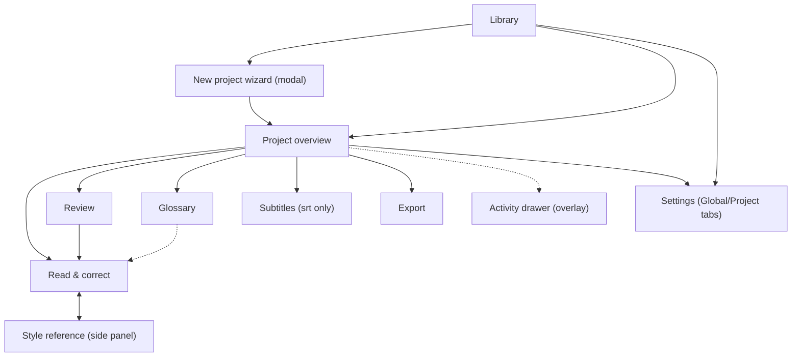

# Desktop GUI

> **Framework: GPUI-Kit 0.8 (DECIDED, U0 passed 2026-10-25).** Iced 0.14
> remains documented as the fallback (§2). Slint/egui rejected.

Target GUI toolkit selection, screen plan, architecture, visual direction, and packaging for the Rust-native Wenyi desktop rewrite.

## 1. Toolkit facts (checked 2026-10-25 unless noted)

| Toolkit | Version | License | Sources |
| --- | --- | --- | --- |
| Iced (fallback) | 0.14.0, released 2025-12-07 | MIT | [Release 0.14.0](https://github.com/iced-rs/iced/releases/tag/0.14.0), [docs.rs](https://docs.rs/crate/iced/0.14.0/source) |
| Slint (rejected) | 1.17 (2026-06-24) | GPL-3.0-only, or royalty-free desktop license, or paid embedded | [Slint 1.17 blog](https://slint.dev/blog/slint-1.17-released), [pricing](https://slint.dev/pricing) |
| egui (rejected) | 0.36.2 (2026-09-08) | MIT OR Apache-2.0 | [egui releases](https://github.com/emilk/egui/releases) |
| GPUI-Kit (DECIDED) | 0.8.0 published and tested (U0); pins `gpui-pre =0.3.9` (Zed snapshot `zed@93d7456`), optional `gpui-fast 0.1.10` fork (not used) | Apache-2.0 (all crates), docs CC BY 4.0 | [repo](https://github.com/longbridge/gpui-kit), [crates.io](https://crates.io/crates/gpui-kit), [LICENSE-APACHE](https://raw.githubusercontent.com/longbridge/gpui-kit/main/LICENSE-APACHE), [Cargo.toml](https://raw.githubusercontent.com/longbridge/gpui-kit/main/Cargo.toml) |

GPUI-Kit facts (verified 2026-10-25, tested at 0.8.0 in U0): one-dependency `gpui-kit = "0.8"`
re-exporting GPUI + `gpui-base` (unstyled behavior/state/infra) +
`gpui-component` (75+ styled components: Sidebar, DataTable, Editor with
tree-sitter/LSP, Dialog, Tabs, Progress, Form, Settings, TextView
Markdown/HTML, Dock, VirtualList, Tree) + assets. Production proof: Longbridge
Pro desktop app. MSRV effectively Rust 1.92+ (via `oo7 0.6.0`). AccessKit
accessibility built in ([docs](https://raw.githubusercontent.com/longbridge/gpui-kit/main/website/docs/accessibility.md)).
Headless UI integration tests incl. Linux offscreen Vulkan
([docs](https://raw.githubusercontent.com/longbridge/gpui-kit/main/website/docs/test.md)).
Theming: semantic `ColorTokens`, light/dark, 20+ built-in themes,
`ThemeRegistry`. Async: GPUI foreground/background executors (`cx.spawn`,
`cx.background_spawn`); tokio bridged via channels, not built in
([docs](https://raw.githubusercontent.com/longbridge/gpui-kit/main/website/docs/task.md)).
Linux: Wayland/X11 sessions + Vulkan driver required; build still needs X11
dev packages (`libxkbcommon-x11-dev` etc.) even on Wayland-only systems
([install docs](https://raw.githubusercontent.com/longbridge/gpui-kit/main/website/docs/installation.md),
[issue #2514](https://github.com/longbridge/gpui-component/issues/2514)); WebView
on Linux needs X11/XWayland; CI covers Ubuntu x86_64 with rendering tests.

Accessibility facts: Slint has production AccessKit integration; egui via
eframe; GPUI-Kit has built-in AccessKit roles/names/states/actions. Iced
screen-reader support is on the roadmap but not shipped as of 0.14
([roadmap discussion](https://news.ycombinator.com/item?id=45599106)).

## 2. Comparison: GPUI-Kit vs Iced (decided for GPUI-Kit)

Slint stays rejected (license friction vs MIT project). egui stays rejected
(weakest retained-app architecture, manual repaint plumbing).

| # | Criterion | GPUI-Kit 0.7 | Iced 0.14 |
| --- | --- | --- | --- |
| 1 | License fit | Apache-2.0: zero friction | MIT: zero friction |
| 2 | Wayland / Linux-first | Supported with caveats: Vulkan driver required, X11 dev packages needed at build time even on Wayland-only, WebView needs XWayland | winit backend, Wayland supported; pure-Rust stack suits Tumbleweed packaging |
| 3 | Async / long-task story | GPUI executors + channel/streaming pattern; tokio bridge needed for the existing engine protocol | Elm `Command`/`Subscription` over tokio; engine streams map directly |
| 4 | Accessibility | Built-in AccessKit | Roadmap only, not shipped |
| 5 | Text editing (proofreading, CJK) | Editor component (tree-sitter, 200k lines); IME quality on Linux **unverified — spike item** | `text_editor` adequate; CJK workable |
| 6 | Component coverage for 13 screens | 75+: Sidebar, DataTable, Dialog, Tabs, Progress, Form, Settings, Markdown/HTML TextView, Dock — closest to the React inventory | Stock widgets only; tables/dock/markdown hand-built |
| 7 | Single-binary distribution | Static binary; heavier system deps (Vulkan, X11 dev libs at build) | Static binary; lighter deps |
| 8 | Theming (minimal) | Semantic tokens + 20 themes; custom minimal theme via `ThemeRegistry` | Full control in Rust |
| 9 | Maturity / risk | Production app (Longbridge Pro) but snapshot-dependence: pins `gpui-pre 0.3.9`, optional `gpui-fast` fork; MSRV 1.92+ | 0.14 most mature Iced; no fork dependence |
| 10 | OS integration (tray, dialogs, updater, keyring) | Via small Rust crates as with Iced; event-loop interop unverified — spike item | Same crates; pattern proven by Tauri shell |
| 11 | Testing | Headless UI integration tests with offscreen Vulkan on Linux | Headless GUI tests; thinner story |

## 3. U0 spike results — PASS (2026-10-25)

**Verdict: GPUI-Kit is viable. D9 ratified for GPUI-Kit 0.8 (see doc 16).**
Spike ran in `/tmp/u0-spike` (isolated; never in the repo), ~2 hours wall time.

Tested versions (locked in `Cargo.lock`): `gpui-kit 0.8.0`,
`gpui-component 0.8.0`, `gpui-base 0.8.0`, `gpui-pre =0.3.9` (Zed snapshot
`zed@93d7456`), `tokio 2.x` (multi-thread runtime), toolchain
`rustc 1.99.1 stable`. Upstream rev at probe time: `7b14e03f` (2026-10-24).
License: Apache-2.0 all crates (verified `crates/*/Cargo.toml` +
`LICENSE-APACHE`); docs CC BY 4.0. Redistribution: preserve copyright +
license text; no copyleft, no commercial restriction. Upstream-first: no fork
needed (`gpui-fast` not used).

| Spike item | Result | Evidence |
|---|---|---|
| 1. Hello-world window on Tumbleweed/Wayland | **PASS** | `Button` + click counter rendered; real click received (`Clicked! total=1`); frames logged; clean `cx.quit()` exit 0; Wayland socket to umbriel ESTAB; AMD GPU (0x1002:0x747e) via Vulkan 1.4 |
| 2. Text input (CJK programmatic) | **PASS (partial)** | `Input` + `InputState` entity: `set_value("hello CJK: ")` + readback `"hello CJK: "` verified. Live IME composition keystrokes NOT tested (no input-injection harness on this Wayland backend); `zwp_text_input_v3` bindings confirmed in `gpui-pre-linux` (`wayland/client.rs:54`) |
| 3. Async bridging (background + tokio) | **PASS** | `cx.spawn` + `background_spawn` → entity update ok; external tokio multi-thread runtime + oneshot channel → entity update ok; `block_on` pre-start ok. UI thread never blocked (all sleeps off-thread) |
| 4. Headless UI test on Linux | **PASS** | Upstream `cargo test -p gpui-kit-recipes --test settings`: `typing_updates_the_owner_after_unrelated_redraws ... ok` (71 s incl. compile) |

Build commands:

```sh
cargo new u0-spike && cd u0-spike
# Cargo.toml: gpui-kit = "0.8" (+ tokio/futures for probe2)
RUSTFLAGS="-L /tmp/u0-spike/native-libs" cargo build   # see sysdeps note
./target/debug/u0-spike            # hello-world + Button + frames
cargo run --bin probe2             # tokio bridge + background + Input probes
```

System packages (openSUSE Tumbleweed): all present except
`libxkbcommon-x11-devel` (headers), which has no passwordless install path
here. Workaround for the spike: symlink
`native-libs/libxkbcommon-x11.so → /usr/lib64/libxkbcommon-x11.so.0` +
`RUSTFLAGS="-L …"`. Production builds need the devel package installed
normally (`zypper in libxkbcommon-x11-devel`). Otherwise: gcc, wayland-devel,
libxkbcommon-devel, libxcb-devel, vulkan-devel, fontconfig-devel all present;
runtime needs a working Vulkan driver (present: radeon + lvp ICDs).

Known limitations (verified, not assumed):

- X11 dev headers required at link time even for pure-Wayland apps
  (linker error `-lxkbcommon-x11` without the symlink; matches upstream
  issue #2514). Packaging must list the devel package.
- GPUI pins are exact (`=0.3.9`); any snapshot bump is a coordinated
  `gpui-kit` release upgrade, not a `cargo update` — depend only on
  `gpui-kit`, never on `gpui-pre*` directly.
- MSRV effectively 1.92+ (via `oo7 0.6.0`); tested toolchain 1.99.1.
- `InputState::set_value` needs `(&mut Window, &mut Context)` — windowed
  context required even for programmatic edits (verified via compiler).
- Live IME composition, multi-hundred-page editor perf, and drag-drop into
  the GPUI window remain untested — carried as U1–U3 risks, not blockers.

## 4. Reference inventory: 13 current screens (parity baseline)

> UI-first rule: the first native implementation reproduces these screens as
> closely as reasonably possible — translation, not redesign. The 7-destination
> consolidation below is the post-parity target, not the first milestone.

Current inventory (`packages/ui/src/routes/manifest.tsx:79-98` routeEntries, 14 entries incl. one redirect; 13 user-facing navEntries in `manifest.tsx:125-139`): Dashboard, CreateProject (`/projects/new`), ProgressPage (`/projects/:pid`), ProofreadingPage (`/projects/:pid/proofreading[/:ci]`), ReviewPage, SubtitlesPage, GlossaryPage, StylePage, ContentsPage, ExportPage, SettingsPage (project), InterfaceSettingsPage (global `/settings`), EventsPage. `navEntries` already groups them into global vs. project audiences and book vs. srt audiences. Full per-screen table (source paths, backend ops, states): doc 04 §1 + `18-desktop-parity.md`.

| Target screen | Type | Merges (post-parity) | Rationale |
| --- | --- | --- | --- |
| Library | destination | Dashboard + CreateProject entry | One home: project list with status chips; "New project" opens the wizard as a modal flow, not a route |
| Project overview | destination | ProgressPage + stats/stages (`packages/backend/wenyi_backend/routers/configuration.py:124-206`) | Run control (start/pause/resume/review/export), stage list, live progress; the single place a running job is visible |
| Read & correct | destination | ContentsPage + ProofreadingPage | Chapter list and segment editor are one workflow (pick chapter, edit segments); keeping them split forces constant switching during a 10k-page book |
| Review | destination | ReviewPage (unchanged scope) | Whole-book review with evidence items stays its own screen; reads the shadow-review publication index (see `12-data-and-persistence.md`) |
| Glossary | destination | GlossaryPage + conflict resolution | Terms list and conflict queue are one workflow today (`packages/backend/wenyi_backend/routers/glossary.py`) |
| Subtitles | conditional | SubtitlesPage (srt audience only) | Shown only for `fmt == "srt"` (same audience rule as `isVisibleFor`, `manifest.tsx:103-107`) |
| Style | reference | StylePage (synopsis/digests) | Read-mostly reference during translation; stays separate so translators can pin it beside Read & correct |
| Export | destination | ExportPage (unchanged scope) | Format/options + export history; native save dialog stays (port `apps/desktop/src/native_export.rs` semantics) |
| Settings | destination | InterfaceSettingsPage + SettingsPage | One settings screen with Global / Project tabs; ends the current split where language policy lives in two places |
| Activity log | drawer | EventsPage demoted to drawer | Event log becomes a slide-over drawer on Project overview, not a destination; nothing in the current log needs full-screen focus |

Net (post-parity): 7 persistent destinations (Library, Overview, Read & correct, Review, Glossary, Export, Settings) + conditional Subtitles + Style reference + Activity drawer.

## 5. Screen relationships



## 6. GUI architecture (toolkit-neutral; binding differs by pick)

- Navigation is a stack of screens; the Activity drawer and New-project wizard
  are overlays, not stack entries.
- Engine binding, phase 1 (UI-first): the native UI talks to the **existing
  Python desktop backend over the loopback REST + WS contract it already
  serves** (`transport.ts` + `runtime.ts`: `apiBase` + bearer token from
  sidecar discovery, WS `/ws/projects/{pid}/progress` with kinds `snapshot |
  stats | state | progress | batch | chapter | term | pipeline | log`). Same
  event taxonomy, new renderer — no new backend protocol. Minimal op list:
  doc 18 §3.
- Engine binding, phase 2 (post-parity): in-process engine calls replace
  loopback HTTP per doc 05; the event taxonomy stays identical.
- Progress rendering: coarse progress at most ~4 Hz (mirrors the 500 ms
  coalescing in `ws.ts:42-53`); chapter/batch/term events invalidate only
  affected rows. A 10k-page book must not re-render the chapter list per
  segment (doc 13 perf budgets).
- State ownership: the GUI holds no translation truth. Data is read from the
  backend on demand per visible screen; edits go through backend operations
  so locks, revision history, and usage ledgers stay single-writer.
- GPUI-Kit binding: `cx.background_spawn` worker owns the HTTP/WS client;
  results return via weak entity updates (channel/streaming pattern per
  GPUI-Kit task docs). Iced fallback binding: `Subscription` over the same
  stream.

## 7. Visual direction: reproduce first, minimal theme after

Phase 1 reproduces the current look: Tailwind + shadcn-style HSL tokens
(`packages/ui/src/index.css`, light/dark via `.dark` class), px-scale spacing
(`tailwind.preset.js`), brand font, existing layout proportions per screen
(doc 18 checklist). Dark and light schemes from day one — do not regress.
The minimal custom theme (small token set, 3 type roles, 2 shapes, restrained
motion) lands only after parity validation.

## 8. Packaging per OS

- Linux (primary, openSUSE Tumbleweed): single binary + `.desktop` file + icon, shipped as RPM (OBS-compatible spec) and tarball. Wayland-tested on GNOME/KDE; X11 fallback via winit.
- Windows: installer (NSIS or WiX) with signed updater channel; keep the `rfd` native-dialog behavior and tray close-to-tray semantics currently in `background.rs`/`native_export.rs`.
- macOS: signed `.dmg` bundle; menu-bar conventions per platform.
- Updates: replace `tauri-plugin-updater` (`apps/desktop/Cargo.toml:26`, `updates.rs:217-234`) with a minimal signed-manifest updater (same `requireSignedVersion` semantics asserted in `updates.rs:449-457`); full design in `13-reliability-and-performance.md`.
- OS integration to port as behavior specs (see shared verdicts): single-instance (port `instance.rs`), tray (`background.rs`), native file dialogs (`rfd` usage in `main.rs:134` and `native_export.rs:428-446`), keyring secrets (`SERVICE = "org.wenyi.desktop"`, `local_credentials.py:23`).

## Sources

- `packages/ui/src/routes/manifest.tsx` (routeEntries, navEntries, isVisibleFor)
- `packages/ui/src/lib/ws.ts` (ProgressMessage kinds, 500 ms coalescing)
- `apps/desktop/frontend/src/` (`main.tsx`, `runtime.ts`, `transport.ts`, `platform.ts`, desktop-only components)
- `apps/desktop/tauri.conf.json` (CSP loopback entries, updater requireSignedVersion)
- `apps/desktop/Cargo.toml` (tauri 2, rfd 0.15, tauri-plugin-updater 2, keyring-adjacent deps)
- `apps/desktop/src/main.rs`, `background.rs`, `instance.rs`, `updates.rs`, `native_export.rs`, `native_drop.rs`
- `packages/backend/wenyi_backend/routers/configuration.py` (stats/stages endpoint), `routers/glossary.py`
- `apps/desktop/backend/wenyi_desktop/local_credentials.py:23`
- Toolkit sources linked in the tables above (all visited 2026-10-25)

## Open questions

See `16-decisions-and-open-questions.md` (updater signing-key custody; RPM maintenance owner; U3 IME retest).
