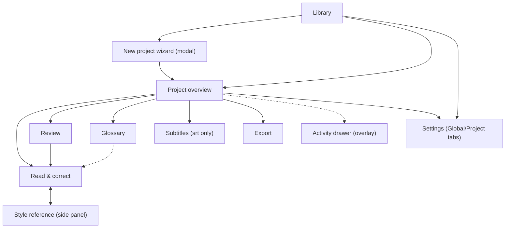

# Desktop GUI

Target GUI toolkit selection, screen plan, architecture, visual direction, and packaging for the Rust-native Wenyi desktop rewrite.

## 1. Verified toolkit facts (checked 2026-10-25)

| Toolkit | Latest version (2026-10-25) | License | Sources |
| --- | --- | --- | --- |
| Iced | 0.14.0, released 2025-12-07 | MIT | [Release 0.14.0](https://github.com/iced-rs/iced/releases/tag/0.14.0), [docs.rs iced 0.14.0](https://docs.rs/crate/iced/0.14.0/source), [HN thread](https://news.ycombinator.com/item?id=46185323) |
| Slint | 1.17 (2026-06-24; 1.15 released 2026-02-04, 1.15.1 patch) | GPL-3.0-only for open source, OR royalty-free Desktop/Mobile/Web license (no royalties for desktop apps), OR paid embedded royalties | [Slint 1.17 blog](https://slint.dev/blog/slint-1.17-released), [Slint 1.15 blog](https://slint.dev/blog/slint-1.15-released.html), [pricing](https://slint.dev/pricing), [royalty-free license (PDF)](https://slint.dev/agreements/slint-royalty-free-license.pdf), [terms](https://slint.dev/terms-and-conditions.html) |
| egui | 0.36.2 (2026-09-08; 0.36.0 improved mobile keyboard/IME/autocorrect) | MIT OR Apache-2.0 | [egui releases](https://github.com/emilk/egui/releases), [CHANGELOG](https://github.com/emilk/egui/blob/master/CHANGELOG.md) |

Accessibility facts: Slint exposes AccessKit-based screen-reader support ([Slint 1.1 blog](https://slint.dev/blog/slint-1.1-released) documents the integration; stability milestone unverified — do not cite a version); [ecosystem survey](https://github.com/intendednull/buiy/blob/main/docs/prior-art/accesskit/ecosystem.md). egui integrates AccessKit via eframe ([accesskit.dev](https://accesskit.dev/)). Iced screen-reader support is on the roadmap but not shipped as of 0.14 ([roadmap discussion](https://news.ycombinator.com/item?id=45599106)).

Release highlights relevant to Wenyi: Iced 0.14 added reactive rendering and time-travel debugging ([CHANGELOG](https://github.com/iced-rs/iced/blob/0.14/CHANGELOG.md)); Slint 1.17 added drag-and-drop and takes the toolkit further toward desktop readiness ([Slint 1.17 blog](https://slint.dev/blog/slint-1.17-released)); Slint 1.12 added WGPU support ([Slint blog](https://slint.dev/blog/)); egui 0.36 added `TextEdit::event_filter` and text-selection fixes.

## 2. Comparison on the 10 mission criteria

Mission criteria for the rewrite target: a modular Rust monolith, single binary, SQLite, no web product, Linux/Wayland-first (openSUSE Tumbleweed), MIT-licensed, Material-3-inspired minimal GUI.

| # | Criterion | Iced 0.14 | Slint 1.17 | egui 0.36 |
| --- | --- | --- | --- | --- |
| 1 | MIT-project license fit | MIT: zero friction, single license for the whole binary | Friction: project code stays MIT but the GUI dependency is GPL-3.0-only unless the royalty-free desktop license (a separate proprietary grant, [terms](https://slint.dev/terms-and-conditions.html)) is accepted and tracked forever | MIT/Apache-2.0: zero friction |
| 2 | Wayland / Linux-first | winit backend, Wayland supported; pure-Rust rendering stack suits Tumbleweed packaging | Wayland supported (FemtoVG/winit and software backends; WGPU since 1.12); Qt backend optional but pulls Qt deps | eframe/winit, Wayland supported (explicit `wayland` feature in egui-winit) |
| 3 | Async / long-task story | Elm-style `Command`/`Subscription` over tokio; engine progress streams map directly onto subscriptions; no manual repaint management | `invoke_from_event_loop` + worker threads; async possible but callback-bridged rather than native | Manual: threads/channels plus `request_repaint`; background translation loop must drive repaints explicitly — workable but boilerplate-heavy for a 10k-page job |
| 4 | Accessibility (screen readers) | Weakest: on roadmap, not shipped | Strongest: production AccessKit integration | Good: AccessKit integration via eframe |
| 5 | Text-editing richness | `text_editor` widget adequate for proofreading panes and glossary editing | `TextEdit`/`LineEdit` with live-preview tooling; declarative bindings reduce editing bugs | Strongest editor (`TextEdit::event_filter` in 0.36.2, IME/autocorrect support) but immediate-mode state must be managed per frame |
| 6 | Multi-screen retained app fit | Best: retained Elm architecture, first-class navigation stacks, testable `update` functions | Good: declarative `.slint` markup separates UI from logic, but splits the codebase across two languages | Weakest: immediate-mode suits tools/HUDs; a 7-screen wizard/review app becomes a state-management exercise |
| 7 | Single-binary distribution | Static Rust binary; no runtime beyond system graphics/fonts | Static binary with software/FemtoVG renderer; style assets compile in | Static binary; font/icon assets embed easily |
| 8 | Theming (Material-3-expressive minimal) | Full control: custom theme + widget styling in Rust; M3-expressive tokens implementable directly | Builtin Material and Cupertino styles, but M3-expressive customization means fighting the stock style or writing a custom one in `.slint` | Custom visuals require hand-rolled widgets; no theme system to speak of |
| 9 | Maturity / docs / hiring surface | 0.14 is the most mature Iced to date (reactive rendering, time-travel debugging); Elm docs map 1:1 onto app code | Most commercially backed (SixtyFPS GmbH), live-preview tooling, Figma integration | Most battle-tested renderer, huge widget ecosystem (egui crates), but app-architecture guidance is thin |
| 10 | OS integration path (tray, dialogs, updater, keyring) | All via small Rust crates (`tray-icon`, `rfd`, `keyring`, custom updater) — same pattern the Tauri shell already proves (see `apps/desktop/src/background.rs`, `native_export.rs`, `updates.rs`) | Same crates usable, but Slint's event loop ownership complicates tray/updater interop | Same crates usable; eframe owns the loop similarly to Iced |

## 3. Recommendation: Iced (provisional verdict confirmed)

Evidence overturns the provisional pick only if a criterion above is factually wrong; verification found no such evidence. Iced wins on criteria 3, 6, 8 (the three that dominate implementation cost for a multi-screen translation workbench) and ties or wins 1, 7, 9, 10. Slint leads only on accessibility (4) and commercial tooling, at the cost of permanent license tracking against an MIT project. egui leads only on raw editor widgets (5), at the cost of the weakest app architecture (6) and manual repaint plumbing for background jobs (3).

Accepted trade-off: Iced has no production screen-reader support. Mitigation is explicit: keep all user-facing strings in a central string table from day one (port `packages/ui/src/i18n` — English + zh-CN — as Fluent/`i18n` resources), keep the widget tree semantic (labels on every control), and re-evaluate Iced accessibility before 1.0; the string-table discipline makes a later toolkit or accessibility-layer swap local. Accessibility work is tracked in `16-decisions-and-open-questions.md`.

## 4. Screen plan: 13 nav entries become 7 persistent destinations

Current inventory (`packages/ui/src/routes/manifest.tsx:79-98` routeEntries, 14 entries incl. one redirect; 13 user-facing navEntries in `manifest.tsx:125-139`): Dashboard, CreateProject (`/projects/new`), ProgressPage (`/projects/:pid`), ProofreadingPage (`/projects/:pid/proofreading[/:ci]`), ReviewPage, SubtitlesPage, GlossaryPage, StylePage, ContentsPage, ExportPage, SettingsPage (project), InterfaceSettingsPage (global `/settings`), EventsPage. `navEntries` already groups them into global vs. project audiences and book vs. srt audiences.

Target IA (native app, no URL routing — a navigation stack replaces paths):

| Target screen | Type | Merges | Rationale |
| --- | --- | --- | --- |
| Library | destination | Dashboard + CreateProject entry | One home: project list with status chips; "New project" opens the wizard as a modal flow, not a route |
| Project overview | destination | ProgressPage + stats/stages (`packages/backend/wenyi_backend/routers/configuration.py:124-206`) | Run control (start/pause/resume/review/export), stage list, live progress; the single place a running job is visible |
| Read & correct | destination | ContentsPage + ProofreadingPage | Chapter list and segment editor are one workflow (pick chapter, edit segments); keeping them split forces constant switching during a 10k-page book |
| Review | destination | ReviewPage (unchanged scope) | Whole-book review with evidence items stays its own screen; reads the shadow-review publication index (see `12-data-and-persistence.md`) |
| Glossary | destination | GlossaryPage + conflict resolution | Terms list and conflict queue are one workflow today (`packages/backend/wenyi_backend/routers/glossary.py`) |
| Subtitles | conditional | SubtitlesPage (srt audience only) | Shown only for `fmt == "srt"` (same audience rule as `isVisibleFor`, `manifest.tsx:103-107`) |
| Style | reference | StylePage (synopsis/digests) | Read-mostly reference during translation; stays separate so translators can pin it beside Read & correct |
| Export | destination | ExportPage (unchanged scope) | Format/options + export history; native save dialog stays (port `apps/desktop/src/native_export.rs` semantics) |
| Settings | destination | InterfaceSettingsPage + SettingsPage | One settings screen with Global / Project tabs; ends the current split where language policy lives in two places |
| Activity log | drawer | EventsPage demoted to drawer | Event log becomes a slide-over drawer on Project overview, not a destination; nothing in the current log needs full-screen focus |

Net: 7 persistent destinations (Library, Overview, Read & correct, Review, Glossary, Export, Settings) + conditional Subtitles + Style reference + Activity drawer.

## 5. Screen relationships

## 6. GUI architecture

Elm architecture, one `Model` per screen plus a shared `App` shell:

- `App { screen: Screen, nav: NavStack, engine: EngineHandle, settings: Settings }`. Each screen is `ScreenModel` + `view(&self) -> Element<Message>` + `update(&mut self, Message) -> Command<Message>`. Navigation is a stack of `Screen` values; the Activity drawer and New-project wizard are overlays, not stack entries.
- Engine binding: the translation engine (ported pipeline, see `07-translation-engine.md` and `05-target-architecture.md`) runs on a dedicated tokio runtime inside the same process. The GUI never calls engine functions directly; it sends `EngineCommand` over an mpsc channel and receives `EngineEvent` over a broadcast channel. Iced `Subscription`s convert the broadcast stream into `Message`s. This is the in-process equivalent of today's WebSocket relay (`packages/ui/src/lib/ws.ts:5-17`; kinds `snapshot | stats | state | progress | batch | chapter | term | pipeline | log`) — same event taxonomy, no sockets. The Tauri CSP (`apps/desktop/tauri.conf.json:17`) currently whitelists `http://127.0.0.1:* ws://127.0.0.1:*` for the loopback sidecar; that entire transport is deleted, not ported.
- Progress rendering: coarse progress (`done/total/label`) updates a header bar at most ~4 Hz (throttle in the subscription, mirroring the 500 ms coalescing in `ws.ts:42-53`); chapter/batch/term events invalidate only the affected list rows. A 10k-page book must not re-render the chapter list per segment — see perf budgets in `13-reliability-and-performance.md`.
- State ownership: the GUI holds no translation truth. Chapter/segment/glossary data is read from SQLite (`12-data-and-persistence.md`) on demand per visible screen; edits go through engine commands so locks, revision history, and usage ledgers stay single-writer.

## 7. Visual direction: Material-3-expressive, minimal

Iced custom theme implementing a small M3 token set: `primary / on-primary / surface / surface-container / outline` + 3 type roles (title/body/label) + 2 shapes (8dp cards, full-pill chips) + one motion rule (150 ms fades for progress, no animation on data lists). No custom widget library: stock Iced widgets (button, text_input, text_editor, scrollable, pick_list, progress_bar) restyled through the theme. Dark and light schemes from day one (the current UI already supports both; do not regress). Density: single comfortable density — no compact mode in v1.

## 8. Packaging per OS

- Linux (primary, openSUSE Tumbleweed): single binary + `.desktop` file + icon, shipped as RPM (OBS-compatible spec) and tarball. Wayland-tested on GNOME/KDE; X11 fallback via winit.
- Windows: installer (NSIS or WiX) with signed updater channel; keep the `rfd` native-dialog behavior and tray close-to-tray semantics currently in `background.rs`/`native_export.rs`.
- macOS: signed `.dmg` bundle; menu-bar conventions per platform.
- Updates: replace `tauri-plugin-updater` (`apps/desktop/Cargo.toml:26`, `updates.rs:217-234`) with a minimal signed-manifest updater (same `requireSignedVersion` semantics asserted in `updates.rs:449-457`); full design in `13-reliability-and-performance.md`.
- OS integration to port as behavior specs (see shared verdicts): single-instance (port `instance.rs`), tray (`background.rs`), native file dialogs (`rfd` usage in `main.rs:134` and `native_export.rs:428-446`), keyring secrets (`SERVICE = "org.wenyi.desktop"`, `local_credentials.py:23`).

## Sources

- `packages/ui/src/routes/manifest.tsx` (routeEntries, navEntries, isVisibleFor)
- `packages/ui/src/lib/ws.ts` (ProgressMessage kinds, 500 ms coalescing)
- `apps/desktop/tauri.conf.json` (CSP loopback entries, updater requireSignedVersion)
- `apps/desktop/Cargo.toml` (tauri 2, rfd 0.15, tauri-plugin-updater 2, keyring-adjacent deps)
- `apps/desktop/src/main.rs`, `background.rs`, `instance.rs`, `updates.rs`, `native_export.rs`, `native_drop.rs`
- `packages/backend/wenyi_backend/routers/configuration.py` (stats/stages endpoint), `routers/glossary.py`
- `apps/desktop/backend/wenyi_desktop/local_credentials.py:23`
- Toolkit sources linked in the tables above (all visited 2026-10-25)

## Open questions

See `16-decisions-and-open-questions.md` (Iced accessibility re-evaluation gate; updater signing-key custody; RPM maintenance owner).
