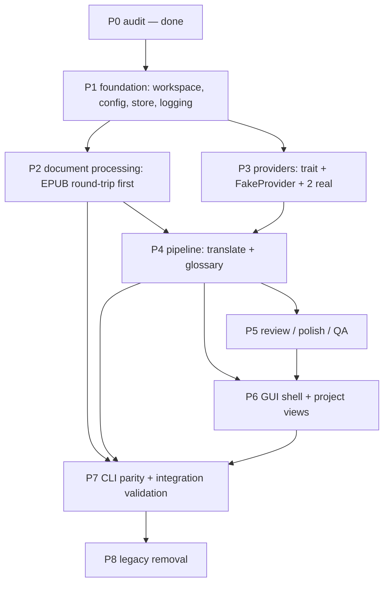

# Migration Roadmap

Phased, dependency-ordered plan for the Rust-native rewrite. Each phase lists scope, dependencies, deliverables, acceptance, risks, and tests. No big bang: every phase lands a working, tested increment on top of the previous one.

## Dependency map

P2 and P3 are independent given P1 (no edge between them) and can proceed in parallel. P6 starts after P4 lands its domain APIs (the GUI renders pipeline state; it must not design its own). P7 integrates everything behind the CLI surface. P8 deletes only after P7 proves parity.

## Why this seam order

The dependency direction in the current codebase (`AGENTS.md`: CLI/Web/Desktop → Orchestrator → domain services → `agents/ingest/glossary/assemble/Storage`) dictates bottom-up porting. Document processing (P2) is deterministic and LLM-free, so it yields the first byte-comparable parity proof without any model access. Providers (P3) are the only network seam, isolated behind `LLMClient`, so they port as one trait plus fakes. The pipeline (P4) is the first phase that needs both — hence it waits for both. GUI (P6) comes after the domain is stable because the current UI (`packages/ui`, 13 routes in `routes/manifest.tsx`) is a thin host over backend state; porting screens before the state exists invites inventing a second contract. CLI parity (P7) doubles as the integration harness. Removal (P8) is last, unconditionally — see `17-removal-plan.md`.

## Phases

### P0 — Audit (done)

Scope: read-only survey of all workspaces. Deliverable: the shared repo brief + per-area audit notes (basis for docs-next). Acceptance: every architectural claim in planning docs cites an existing path. No tests.

### P1 — Foundation

Scope: Cargo workspace layout (`crates/` for domain, `crates/cli`, `crates/gui`), config loading (YAML defaults byte-identical to `_DEFAULT_CONFIG_YAML` in `packages/core/wenyi_core/config.py`), SQLite store (artifact keys, atomic commit, run locks), logging with secret redaction, error taxonomy.
Dependencies: P0. Deliverables: building workspace, config + store + logging crates with unit tests.
Acceptance: default config renders byte-identical YAML; store round-trip + crash-recovery tests green; canary-secret log test green.
Risks: SQLite concurrency semantics differing from Python `sqlite3` usage — mitigate by porting the lock discipline (`packages/core/wenyi_core/storage/` + `apps/desktop/backend/wenyi_desktop/local_*.py` patterns), not inventing new ones.
Tests: deterministic unit tests; see doc 14 §4.

### P2 — Document processing (EPUB round-trip first)

Scope: port `ingest/` readers (EPUB first, then FB2/HTML/TXT/DOCX/SRT), `markup/` anchor/annotation handling, `assemble/` writers (EPUB first), stable `Segment`/`Chapter`/`Document` models. LLM-free.
Dependencies: P1 (store for parsed artifacts). Deliverables: `ingest` + `assemble` crates with a golden-file corpus.
Acceptance: EPUB round-trip golden files byte-stable; segment IDs stable across re-runs; all other formats parse to identical segment streams vs Python on fixtures.
Risks: EPUB navigation/metadata edge cases (`assemble/epub_navigation.py`, `epub/presentation.py`) — mitigate with a corpus EPUB covering nav variants.
Tests: fixture-based parity corpus; see doc 14 §4.

### P3 — Providers

Scope: `LlmClient` trait (port of `packages/core/wenyi_core/llm/base.py`), tier routing (strong/cheap/fast per `llm/router.py`), retry ownership (`llm/retrying.py`), usage ledger, `FakeProvider` (port of `FakeClient` + `tests/fake_llm.py` routing), two real providers (OpenAI-compatible base + one more, e.g. DeepSeek) with SDK retries disabled.
Dependencies: P1. Deliverables: provider crate + scripted fake.
Acceptance: tier-route matrix green against fake; retry test proves single-owner retries; usage append-once under retry; canary-secret test proves no key in logs.
Risks: provider protocol drift — mitigate by keeping protocol knowledge (endpoints, error shapes) in per-provider modules as in `llm/providers/`.
Tests: mock-tier tests, error-mapping tests; see doc 14 §4.

### P4 — Pipeline: translate + glossary

Scope: port preparation/orchestration (`pipeline/preparation.py`, `orchestrator.py` as thin facade), translation + batching + rolling context (`pipeline/translation*.py`, `context.py`, `title_translation.py`), glossary store/matcher/extractor/resolver (`glossary/`), SRT independent pipeline (`srt/`).
Dependencies: P2 (segments), P3 (LLM). Deliverables: end-to-end fake-LLM book translation with glossary enforcement.
Acceptance: fixture book translates identically (modulo model output) in structure; resume-after-kill test green; usage ledger exact; 50k-word before/after quality eval recorded (doc 14 §3).
Risks: context-window and batching behavior drift — mitigate by porting algorithms, not reimplementing, and testing against recorded multi-turn fake scripts.
Tests: golden glossary files, resume/chaos tests, eval harness v1; see doc 14 §§4–5.

### P5 — Review / polish / QA

Scope: port `pipeline/review_*.py` + `autofix_*`, `agents/review_*`, `review/` evidence/conflict/session models, polisher, precision paths, report/finalization (`pipeline/finalization.py`, `assemble/report/`).
Dependencies: P4. Deliverables: review workflow with shadow-only enforcement + autofix publishing via recoverable index.
Acceptance: shadow-only invariant test (formal targets untouched until autofix); evidence/conflict golden tests; human-judged before/after eval on a public-domain book.
Risks: autofix publishing bugs corrupt formal text — mitigate with the recoverable-index requirement and rollback tests.
Tests: port of `test_review*.py`; see doc 14 §4.

### P6 — GUI

Scope: native GUI (framework per doc 16) with the 13-screen inventory from `packages/ui/routes/manifest.tsx` as UX spec, progress/event rendering (port of the `/ws/projects/{pid}/progress` event kinds as in-process messages), single-instance/tray/dialogs/updater/keyring behaviors (ports of `apps/desktop/src/` modules + `local_credentials.py` keyring discipline).
Dependencies: P4 (domain APIs), P5 (review screens need review state). Deliverables: working desktop app against local SQLite, no web product.
Acceptance: headless GUI tests for project lifecycle; platform tests for single-instance, tray, dialogs, signed updater; keyring negative test (no plaintext secrets).
Risks: framework immaturity on Wayland — decision and fallback in doc 16.
Tests: GUI + platform tests; see doc 14 §4.

### P7 — CLI parity + integration validation

Scope: CLI surface port (commands in `packages/cli` as spec), full fixture-book run Python-vs-Rust artifact comparison, packaging (single binary, Linux-first per target verdicts).
Dependencies: P2 + P4 + P6. Deliverables: CLI with identical command/flag surface; integration report.
Acceptance: CLI help/flag diff empty vs Python CLI; fixture-book artifacts structurally identical; full offline suite green on clean checkout; quality eval recorded.
Risks: flag-parity drift — mitigate with a generated parity test from the Typer app definition.
Tests: CLI parity tests, end-to-end comparison; see doc 14 §4.

### P8 — Legacy removal

Scope: delete per `17-removal-plan.md`, in dependency-safe order, each item only after its parity precondition is proven.
Dependencies: P7. Deliverables: Rust-only repo (+ `docs/` as reference, LICENSE, history).
Acceptance: per-item preconditions + verification steps all signed off; grep-clean for removed symbols; build + suite green without Python/Node toolchains.
Risks: premature deletion — mitigated structurally: nothing is removed before migrated + validated (doc 17).

## First implementation task (recommended)

P1 config + logging skeleton: create the Cargo workspace, port `_DEFAULT_CONFIG_YAML` loading with a byte-identical test, and add the secret-redacting logger with the canary test. Rationale: it is the smallest task that establishes the workspace conventions, the evidence-citation habit, and the secret-handling discipline every later phase depends on — and it is fully verifiable without network, models, or fixtures.

## No-big-bang rationale

The current system earns its reliability from layered, independently tested seams (AGENTS.md dependency rules + boundary tests + integration gating). A rewrite that replaces everything at once discards all of that evidence simultaneously and debugs the union of all possible regressions. Phased migration keeps a working comparison oracle (the Python implementation) alive until P8, so every phase can diff against ground truth instead of arguing from memory.

## Sources

- `AGENTS.md` (dependency direction, boundary-test mandates)
- `packages/core/wenyi_core/config.py` (`_DEFAULT_CONFIG_YAML`); `packages/core/wenyi_core/storage/`; `packages/core/wenyi_core/llm/`; `packages/core/wenyi_core/ingest/`; `packages/core/wenyi_core/assemble/`; `packages/core/wenyi_core/glossary/`; `packages/core/wenyi_core/srt/`; `packages/core/wenyi_core/pipeline/`; `packages/core/wenyi_core/review/`
- `packages/ui/routes/manifest.tsx` (13 routes); `packages/backend/wenyi_backend/routers/ws.py` (`/ws/projects/{pid}/progress`)
- `apps/desktop/src/` (9 modules); `apps/desktop/backend/wenyi_desktop/local_credentials.py` (keyring)
- `packages/cli` (Typer surface)

## Open questions

See `16-decisions-and-open-questions.md`.
