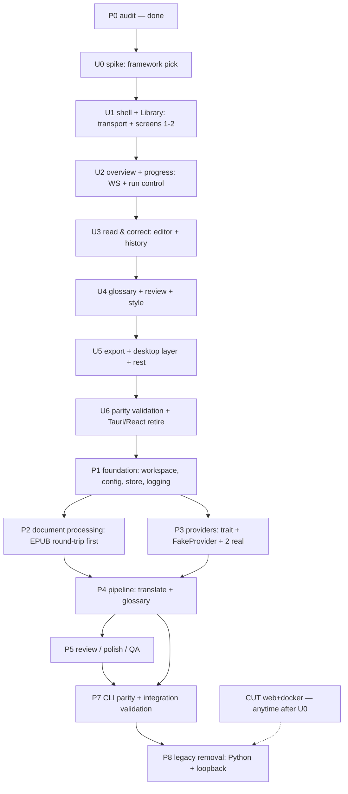

# Migration Roadmap

Phased, dependency-ordered plan for the Rust-native rewrite. Each phase lists scope, dependencies, deliverables, acceptance, risks, and tests. No big bang: every phase lands a working, tested increment on top of the previous one. **UI-first order (revised 2026-10-25):** the native GUI is rebuilt against the live Python backend first (U-phases), then the engine is ported behind the stable UI (P-phases) — the Tauri app stays as fallback until parity.

## Dependency map

U0–U6 rebuild the UI against the **live Python backend** (doc 18); the Tauri
app stays as fallback until U6. P1–P5 then port the engine behind the stable
native UI; P7 validates; P8 deletes Python + the loopback contract. The
web+docker cut (doc 17 rows 1–4) is independent — proven safe now, executable
anytime (recommended: right after U0, to shrink the tree before UI work).

Minimal-first scoping: each phase ports the smallest behavior that keeps the
product coherent, deferring the rest explicitly. U1–U5 follow doc 18 §5 order.
P2 = EPUB + TXT/MD/HTML first (DOCX/SRT/FB2 next, PDF last per doc 09 §4).
P3 = OpenAI-compatible + DeepSeek + Ollama first (D5a). P4 = standard mode
first, `best_of_three` after. P5 = review + autofix first, precision paths
only if the eval corpus proves need. Anything deferred is recorded in the
phase acceptance record (doc 14 §6), not silently dropped.

## Why this seam order

The UI is a thin host over backend state (`packages/ui`, 13 routes in
`routes/manifest.tsx`; desktop transport in `transport.ts`/`runtime.ts`), so
rebuilding it first against the **unchanged loopback contract** cannot invent
a second contract — the contract is the spec (doc 18 §3). The Python backend
stays the behavior oracle throughout; engine phases (P1–P5) then port behind
a stable, already-validated UI. CLI parity (P7) doubles as the integration
gate before Python deletion (P8).

## Phases

### P0 — Audit (done)

Scope: read-only survey of all workspaces. Deliverable: the shared repo brief + per-area audit notes (basis for docs-next). Acceptance: every architectural claim in planning docs cites an existing path. No tests.

### U0 — Framework spike (done, PASS 2026-10-25)

Scope was the four pass/fail items in doc 10 §3. All green; D9 ratified for
GPUI-Kit 0.8. Evidence: doc 10 §3 results table + locked versions. Residual
risk (live IME composition) retests in U3.

### U1 — Shell + Library (in progress: shell + Dashboard done 2026-10-25)

Scope: native window + nav shell + Dashboard + Create project (doc 18 §5 step 1). Backend: live Python sidecar via loopback REST (discovery, list/create/preview/upload).
Dependencies: U0 (done, PASS). Deliverables: app that lists and creates projects against the real backend.
Acceptance: screen 1–2 checklist (doc 18 §6); multipart upload + preview work; Tauri app untouched as fallback.
Progress 2026-10-25: `apps/desktop/native/` scaffolded (`main`, `backend`, `client`, `theme`, `views::{app,dashboard}`); sidecar spawn + attach + shutdown verified live; Dashboard `GET /projects` + 5s refetch + delete flow verified against real sidecar; `scripts/desktop-ui.sh [old|native]` switching works. Remaining: Create project screen (upload + preview + multipart), Dashboard card click-through, dark mode wiring, pixel-level visual comparison (no screenshot path in this environment).
Risks: sidecar discovery protocol mismatch — mitigated by reusing the exact `runtime.ts`/`transport.ts` semantics.
Tests: headless UI tests for list/create; transport unit tests; see doc 14 §4.

### U2 — Overview + progress (WS + run control)

Scope: Progress/overview screen (doc 18 §5 step 2): run control (translate/prepare/pause/resume), WS progress rendering, report view.
Dependencies: U1. Deliverables: end-to-end translation run driven from the native UI.
Acceptance: screen 3 checklist; 4 Hz coarse progress + targeted invalidation; export bytes identical vs Tauri-driven run on the fixture book.
Risks: WS reconnect/backoff parity — mitigate by porting `ws.ts` semantics exactly.
Tests: mocked-stream progress tests + live-backend run test; see doc 14 §4.

### U3 — Read & correct (editor + history)

Scope: Contents + Proofreading screens (doc 18 §5 step 3): chapter list, segment editor, revision history, precision drafts.
Dependencies: U2. Deliverables: full chapter/segment read + edit path.
Acceptance: screens 6+8 checklist; CJK editing verified by a human pass; edit → persisted + visible ≤ 100 ms (doc 13 budget).
Risks: editor component gaps (IME, large chapters) — spike de-risks, but real-book testing may surface more; record as U6 caveats, not silent cuts.
Tests: editor + history tests; see doc 14 §4.

### U4 — Glossary + review + style

Scope: Glossary, Review, Style screens (doc 18 §5 steps 4–5): term tables + conflicts + import/export, review runs + evidence, synopsis/digest editing.
Dependencies: U3. Deliverables: terminology + QA workflows in the native UI.
Acceptance: screens 4+5+7 checklist; conflict resolve + review run work end to end against the live backend.
Risks: DataTable perf on large glossaries — mitigate with virtualized lists + paged reads.
Tests: table/dialog/run tests; see doc 14 §4.

### U5 — Export + desktop layer + rest

Scope: Export + native save, credentials/MinerU, updater + release notes, Settings (project + interface), Subtitles, Events (doc 18 §5 steps 6–7). Single-instance/tray/dialogs/keyring ports.
Dependencies: U4. Deliverables: feature-complete native desktop app.
Acceptance: screens 9–13 checklist + desktop-only layer; keyring negative test (no plaintext secrets); signed updater test.
Risks: updater-channel continuity for existing installs (Q4 must land before U6).
Tests: platform tests (instance, tray, dialogs, updater, keyring); see doc 14 §4.

### U6 — Parity validation + Tauri/React retire

Scope: full doc 18 §6 checklist across all screens (light + dark, en + zh-CN), then delete the Tauri shell + React frontend + `@wenyi/ui` + `shared-schema` per doc 17 rows 1–2 + 6 (TS part).
Dependencies: U5. Deliverables: native UI as the only desktop UI; removal record.
Acceptance: every screen checklist signed off; desktop E2E-equivalent coverage green; `grep from '@wenyi/` empty; Python backend + CLI untouched and passing.
Risks: premature deletion — mitigated structurally (doc 17 preconditions).
Tests: parity suite; see doc 14 §4.
### P1 — Foundation (engine port starts here)

Scope: Cargo workspace layout for the engine (`store`, `llm`, `doc`, `engine`, `cli` crates; `gui` crate already exists from U-phases), config loading (YAML defaults byte-identical to `_DEFAULT_CONFIG_YAML`), SQLite store (artifact keys, atomic commit, run locks), logging with secret redaction, error taxonomy.
Dependencies: U6 (stable native UI + loopback contract as the integration spec). Deliverables: building workspace, config + store + logging crates with unit tests.
Acceptance: default config renders byte-identical YAML; store round-trip + crash-recovery tests green; canary-secret log test green.
Risks: SQLite concurrency semantics differing from Python `sqlite3` usage — mitigate by porting the lock discipline (`packages/core/wenyi_core/storage/` + `apps/desktop/backend/wenyi_desktop/local_*.py` patterns), not inventing new ones.
Tests: deterministic unit tests; see doc 14 §4.

### P2 — Document processing (EPUB round-trip first)

Scope: port `ingest/` readers (EPUB first, then FB2/HTML/TXT/DOCX/SRT), `markup/` anchor/annotation handling, `assemble/` writers (EPUB first), stable `Segment`/`Chapter`/`Document` models. LLM-free.
Dependencies: P1 (store for parsed artifacts). Deliverables: `ingest` + `assemble` crates with a golden-file corpus.
Acceptance: EPUB round-trip golden files byte-stable; segment IDs stable across re-runs; all other formats parse to identical segment streams vs Python on fixtures.
Risks: EPUB navigation/metadata edge cases (`assemble/epub_navigation.py`, `epub/presentation.py`) — mitigate with a corpus EPUB covering nav variants.
Tests: fixture-based parity corpus; see doc 14 §4.

### P3 — Providers

Scope: `LlmClient` trait (port of `packages/core/wenyi_core/llm/base.py`), tier routing (strong/cheap/fast per `llm/router.py`), retry ownership (`llm/retrying.py`), usage ledger, `FakeProvider` (port of `FakeClient` + `tests/fake_llm.py` routing), two real providers (OpenAI-compatible base + one more, e.g. DeepSeek) with SDK retries disabled.
Dependencies: P1. Deliverables: provider crate + scripted fake.
Acceptance: tier-route matrix green against fake; retry test proves single-owner retries; usage append-once under retry; canary-secret test proves no key in logs.
Risks: provider protocol drift — mitigate by keeping protocol knowledge (endpoints, error shapes) in per-provider modules as in `llm/providers/`.
Tests: mock-tier tests, error-mapping tests; see doc 14 §4.

### P4 — Pipeline: translate + glossary

Scope: port preparation/orchestration (`pipeline/preparation.py`, `orchestrator.py` as thin facade), translation + batching + rolling context (`pipeline/translation*.py`, `context.py`, `title_translation.py`), glossary store/matcher/extractor/resolver (`glossary/`), SRT independent pipeline (`srt/`).
Dependencies: P2 (segments), P3 (LLM). Deliverables: end-to-end fake-LLM book translation with glossary enforcement.
Acceptance: fixture book translates identically (modulo model output) in structure; resume-after-kill test green; usage ledger exact; 50k-word before/after quality eval recorded (doc 14 §3).
Risks: context-window and batching behavior drift — mitigate by porting algorithms, not reimplementing, and testing against recorded multi-turn fake scripts.
Tests: golden glossary files, resume/chaos tests, eval harness v1; see doc 14 §§4–5.

### P5 — Review / polish / QA

Scope: port `pipeline/review_*.py` + `autofix_*`, `agents/review_*`, `review/` evidence/conflict/session models, polisher, precision paths, report/finalization (`pipeline/finalization.py`, `assemble/report/`).
Dependencies: P4. Deliverables: review workflow with shadow-only enforcement + autofix publishing via recoverable index.
Acceptance: shadow-only invariant test (formal targets untouched until autofix); evidence/conflict golden tests; human-judged before/after eval on a public-domain book.
Risks: autofix publishing bugs corrupt formal text — mitigate with the recoverable-index requirement and rollback tests.
Tests: port of `test_review*.py`; see doc 14 §4.

### (P6 retired — superseded by U0–U6; number kept vacant to preserve history.)

### P7 — CLI parity + integration validation

Scope: CLI surface port (commands in `packages/cli` as spec), full fixture-book run Python-vs-Rust artifact comparison, packaging (single binary, Linux-first per target verdicts). Native UI switches from loopback HTTP to in-process engine calls (taxonomy unchanged, doc 10 §6).
Dependencies: P2 + P4 + U6. Deliverables: CLI with identical command/flag surface; in-process UI binding; integration report.
Acceptance: CLI help/flag diff empty vs Python CLI; fixture-book artifacts structurally identical; full offline suite green on clean checkout; quality eval recorded; UI works identically over in-process binding.
Risks: flag-parity drift — mitigate with a generated parity test from the Typer app definition.
Tests: CLI parity tests, end-to-end comparison; see doc 14 §4.

### P8 — Legacy removal

Scope: delete per `17-removal-plan.md`, in dependency-safe order, each item only after its parity precondition is proven. (Web+docker rows may already be cut — see CUT edge.)
Dependencies: P7. Deliverables: Rust-only repo (+ `docs/` as reference, LICENSE, history).
Acceptance: per-item preconditions + verification steps all signed off; grep-clean for removed symbols; build + suite green without Python/Node toolchains.
Risks: premature deletion — mitigated structurally: nothing is removed before migrated + validated (doc 17).

## First implementation task (done: U0 PASS; next: U1)

U1 shell + Library (doc 18 §5 step 1, doc 15 U1): native window + nav shell + Dashboard + Create project against the live Python sidecar. Requires explicit U1 authorization per the U0 task — not started here.

## No-big-bang rationale

The current system earns its reliability from layered, independently tested seams (AGENTS.md dependency rules + boundary tests + integration gating). A rewrite that replaces everything at once discards all of that evidence simultaneously and debugs the union of all possible regressions. Phased migration keeps a working comparison oracle (the Python implementation) alive until P8, so every phase can diff against ground truth instead of arguing from memory.

## Sources

- `AGENTS.md` (dependency direction, boundary-test mandates)
- `packages/core/wenyi_core/config.py` (`_DEFAULT_CONFIG_YAML`); `packages/core/wenyi_core/storage/`; `packages/core/wenyi_core/llm/`; `packages/core/wenyi_core/ingest/`; `packages/core/wenyi_core/assemble/`; `packages/core/wenyi_core/glossary/`; `packages/core/wenyi_core/srt/`; `packages/core/wenyi_core/pipeline/`; `packages/core/wenyi_core/review/`
- `packages/ui/routes/manifest.tsx` (13 routes); `packages/backend/wenyi_backend/routers/ws.py` (`/ws/projects/{pid}/progress`)
- `apps/desktop/src/` (9 modules); `apps/desktop/backend/wenyi_desktop/local_credentials.py` (keyring)
- `packages/cli` (Typer surface)

## Open questions

See `16-decisions-and-open-questions.md`.
